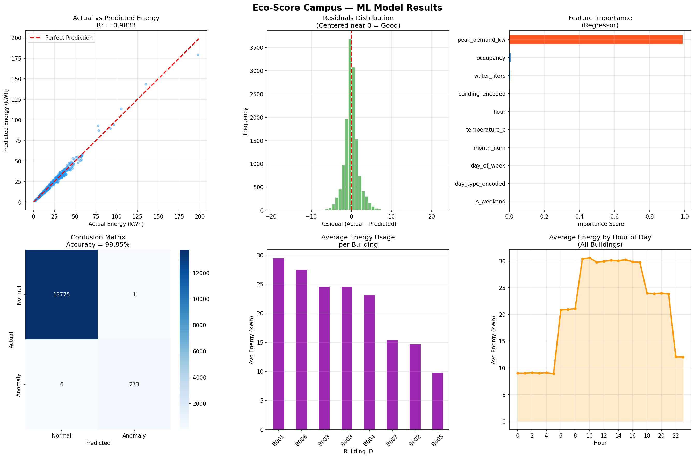

# ECO-SCORE CAMPUS SUSTAINABILITY MONITORING 

[](https://www.python.org/)
[](https://flask.palletsprojects.com/)
[](https://scikit-learn.org/)
[](LICENSE)

**EcoScore OS** is an enterprise-grade campus sustainability intelligence platform. Powered by machine learning ensembles (Gradient Boosting), it monitors real-time smart meter telemetry across campus facilities to predict electrical load profiles, detect anomalous water and energy spikes, and accelerate institutional decarbonization roadmaps.

---

## 🌟 Key Highlights

- **Modern Light Glassmorphic Dashboard**: A high-contrast, responsive UI utilizing full screen real estate with micro-charts, sparklines, radial circular progress gauges, and segmented project milestone tracks.
- **Dual ML Engine**:
  - **Model 1 (Load Forecast)**: `GradientBoostingRegressor` predicting energy consumption ($R^2 = 0.9833$, $\text{RMSE} = 1.95\text{ kWh}$).
  - **Model 2 (Anomaly Sentinel)**: `GradientBoostingClassifier` flagging equipment faults and off-hours leaks ($99.95\%$ Accuracy, $0.9873$ F1 Score).
- **Submeter Telemetry Pipeline**: Built-in CSV data ingest engine for validating and processing smart meter readings across 8 distinct campus facility clusters.
- **Autonomous Operations & AI Copilot**: Interactive facility maintenance task management, audit calendars, and integrated AI assistant for load shedding recommendations.

---

## 📊 Machine Learning Performance

Both models were trained and validated on a historical dataset of **70,272 hourly campus utility readings** spanning 8 facilities.

| Metric | Regressor (Energy Forecast) | Classifier (Anomaly Detection) |
| :--- | :--- | :--- |
| **Algorithm** | Gradient Boosting Regressor | Gradient Boosting Classifier |
| **Estimators / Depth** | 200 Trees / Depth 5 | 200 Trees / Depth 4 |
| **Accuracy / $R^2$** | **$R^2 = 0.9833$** | **$99.95\%$ Accuracy** |
| **Precision** | — | **$0.9964$** |
| **Recall** | — | **$0.9785$** |
| **F1 Score** | — | **$0.9873$** |
| **Error Metric** | $\text{RMSE} = 1.9537\text{ kWh}$, $\text{MAE} = 1.3060\text{ kWh}$ | Log-loss minimized |



---

## 🏢 Monitored Campus Facilities

| ID | Facility Name | Primary Use | Baseline Benchmark |
| :---: | :--- | :--- | :---: |
| **B001** | Main Academic Block | Lecture halls, faculty offices | $1,200\text{ kWh/day}$ • $6,000\text{ L/day}$ |
| **B002** | Library | Silent study, archives, digital labs | $600\text{ kWh/day}$ • $2,000\text{ L/day}$ |
| **B003** | Hostel Block A | Student residential living | $800\text{ kWh/day}$ • $8,000\text{ L/day}$ |
| **B004** | Hostel Block B | Student residential living | $750\text{ kWh/day}$ • $7,500\text{ L/day}$ |
| **B005** | Admin Block | Registrar, executive offices | $400\text{ kWh/day}$ • $1,500\text{ L/day}$ |
| **B006** | Sports Complex | Gymnasium, aquatic center | $900\text{ kWh/day}$ • $10,000\text{ L/day}$ |
| **B007** | Canteen | Commercial kitchens, dining hall | $500\text{ kWh/day}$ • $5,000\text{ L/day}$ |
| **B008** | Lab Block | Clean rooms, computing clusters | $1,000\text{ kWh/day}$ • $3,000\text{ L/day}$ |

---

## 📁 Repository Structure

```text
EcoScore-AI/
├── app.py                         # Flask web application & REST APIs
├── eco_score_model.py             # Model training, evaluation & artifact generation
├── requirements.txt               # Python package dependencies
├── campus_utility_full.csv        # 70,272 hourly meter readings dataset
├── energy_forecast_model.pkl      # Pre-trained Gradient Boosting Regressor
├── anomaly_detector_model.pkl     # Pre-trained Gradient Boosting Classifier
├── building_encoder.pkl           # Label encoder for facility IDs
├── day_type_encoder.pkl           # Label encoder for operating day types
├── model_results.png              # ML model evaluation charts & heatmaps
├── eco_score_dashboard.png        # Historical baseline visualizations
├── templates/
│   ├── base.html                  # Core layout shell, navigation & design system
│   ├── index.html                 # Main dashboard with KPI cards, milestones & charts
│   ├── anomalies.html             # Anomaly Sentinel surveillance table & breakdown
│   ├── predict.html               # Interactive ML inference simulator
│   └── upload.html                # CSV meter telemetry ingest pipeline
└── README.md                      # Project documentation
```

---

## 🚀 Quickstart Guide

### 1. Clone the Repository
```bash
git clone https://github.com/DenisCham/EcoScore-AI.git
cd EcoScore-AI
```

### 2. Set Up Virtual Environment (Recommended)
```bash
# Windows
python -m venv .venv
.venv\Scripts\activate

# macOS / Linux
python3 -m venv .venv
source .venv/bin/activate
```

### 3. Install Dependencies
```bash
pip install -r requirements.txt
```

### 4. (Optional) Retrain ML Models
To train fresh weights from `campus_utility_full.csv`:
```bash
python eco_score_model.py
```

### 5. Launch the Web Portal
```bash
python app.py
```
Open your browser and navigate to:
👉 **[http://127.0.0.1:5000](http://127.0.0.1:5000)**

---

## 🔌 API Endpoints

| Endpoint | Method | Description |
| :--- | :---: | :--- |
| `/` | `GET` | Main Operations Dashboard |
| `/anomalies` | `GET` | Anomaly Sentinel surveillance view |
| `/predict` | `GET`, `POST` | Real-time machine learning prediction simulator |
| `/upload` | `GET`, `POST` | CSV telemetry batch ingest and validation |
| `/api/dashboard` | `POST` | JSON telemetry aggregator for weekly and monthly time-series |

---

## 👤 Author

**Denis Cham**
- GitHub: [@DenisCham](https://github.com/DenisCham)
- Email: denischamf@gmail.com

---

## 📄 License
This project is open-source and licensed under the [MIT License](LICENSE).
